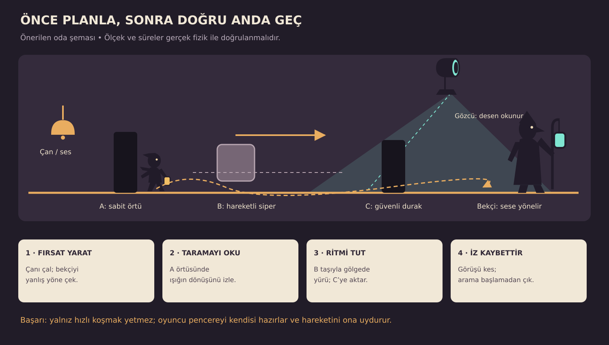
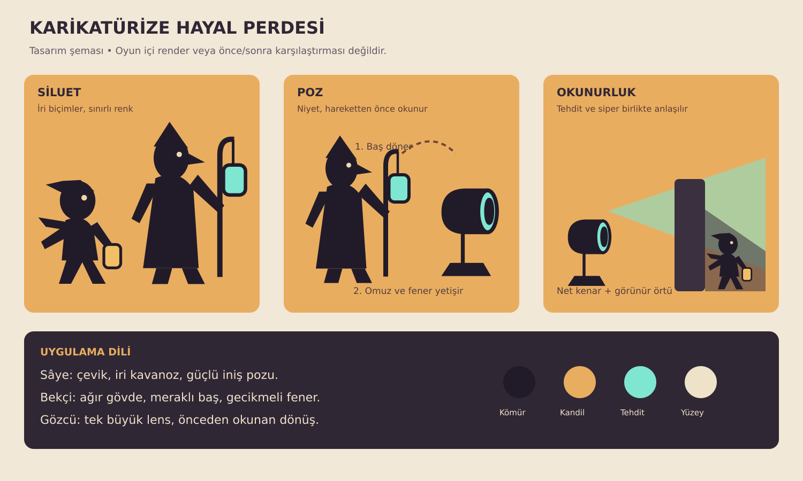

# Gölge Oyunu — Bölüm, beceri ve görsel yön raporu

**22 Ekim 2026 · İncelenen temel: `80ad815` · Tasarım önerisi, uygulama yapılmadı.**

Bu rapor 17 bölümün tanımlarına ve haritalarına; karakter fiziğine; Kandilci, Gözcü, fener, kurt, bulmaca ve çizim kodlarına; mevcut oyun görsellerine dayanır. Önceki incelemede ana test koşusundaki 191 test geçti. Bu çalışma 17 bölümün tamamının insan oyuncuyla bitirildiği bir oynanabilirlik testi değildir. Aşağıdaki süreler, hızlar ve başarı oranları **prototipte sınanacak tasarım hedefleridir**; ölçülmüş oyuncu sonuçları değildir. Eski `ZORLUK.md` notları güncel kodla karşılaştırılmıştır.

**Ana karar:** Oyunun yönü, karikatürize bir hayal perdesinde **gözlem → plan → doğru anda hareket → tatmin edici kaçış** olmalı. Platform alanları ise **ritim → sıçrama → iyi iniş → kısa rahatlama** döngüsünü taşımalı. Zorluk, oyuncunun okuyabildiği kuralları birlikte kullanmasından doğmalı.

## 1. Önce hangi sorun çözülmeli?

Oyunda içerik ve mekanik çeşitliliği zaten yüksek. Öncelik yeni bölüm eklemekten önce mevcut karşılaşmaların karar gerektirmesini sağlamak. Aynı davranışın farklı dekorlarla tekrarlandığı alanlar, daha çok düşmanla doldurulmak yerine farklı rota ve ritimlerle yeniden kurulmalı.

| Kodda görülen durum | Oyuncuya olası etkisi | Tasarım kararı |
|---|---|---|
| Sâye koşu 160 px/sn; Kandilci kovalamaca 130 px/sn | Açık koridorda kaçmak baskın çözüm olabilir | Kaçışı kısa hatlara böl; görüş kesme, köşe, hareketli siper ve arama davranışı ekle |
| Kandilci ateşböceğine dönünce şüphe sıfırlanıyor, temasla da yakalamıyor | Ateşböceği pek çok durumda genel kurtuluş düğmesine dönüşebilir | Görüş, mesafe, dikkat süresi ve hangi bekçinin yemi sahiplendiği kurallı olsun |
| `_noticeLure` içinde mesafe/yükseklik kontrolü var, görüş hattı koşulu yok | Duvar arkasındaki yem bekçiyi etkileyebilir | Yem görülmeli veya açıkça duyulur bir etkisi olmalı; ikisini ayrı modelle |
| Gözcü ışığı yaklaşık 0,74 sn, balon yaklaşık 0,56 sn maruziyette yakalıyor; Konya büyük feneri 0,1 sn üstünde öldürüyor | Benzer görünen tehditler farklı tepki süreleri istiyor | Tehdit sınıfları görsel biçim, ses ve öğretimle ayrılmalı; ortak maruziyet dili kurulmalı |
| Hareketli kaya 2 kare genişlikte, 4 kare yol ve 5,5 sn dönemle çalışıyor | Farklı yerlerde benzer bekleme ve atlama hissi | Bölüm verisinden yol, durak, dönem, başlangıç evresi ve genişlik seçilebilsin |
| Ergenekon'da `noWings: true` zaten var | Önceki kanat önerisinin bir kısmı uygulanmış | Burada yeni iş: ritim, kaynak taşıma ve zamanlı tırmanışı geliştirmek |
| Kurt 0,32 sn hazırlanıp 0,45 sn, normal hızının 1,35 katıyla atılıyor | Zaten zamanlamalı bir tehdit temeli var | Yeni bir atılma sistemi yazmak yerine hazırlık okunurluğunu ve kaçış alanlarını iyileştir |
| 0,10 sn coyote time, 0,12 sn zıplama tamponu, değişken sıçrama mevcut | Affedici hareket altyapısı hazır | Bu yardımları koru; zorluğu rota seçiminden ve zamanlamadan üret |

**Kaçınılacak ilk hamle:** Bütün bekçileri hızlandırmak, bütün platformları küçültmek ve bütün ışıkları daha erken öldürücü yapmak. Bunlar kısa vadede ölüm sayısını artırır; her sahneyi daha ilginç yapmaz.

## 2. Bekçiden kaçış: zamanlama ve zekâ birlikte

### 2.1 Oyuncunun üç ayrı işi olsun

1. **Okuma:** Bekçi nerede duruyor, hangi sesle dönüyor, hangi yere bakıyor? Omuz, baş ve fener hareketi bunu önceden anlatmalı.
2. **Plan:** Hangi siper, ses kaynağı veya ateşböceği kullanılacak? Görülürsem hangi güvenli yere ulaşacağım?
3. **Uygulama:** Fırsat açıldığında koş, gerektiğinde sessizleş, görüşü kes ve arama alanından uzaklaş.

Oyuncu başarısız olunca “hangi kuralı yanlış okuduğunu” anlayabilmeli. Başarılı olunca kendi kurduğu planı uyguladığını hissetmeli.

### 2.2 Kandilci için durum akışı

**Devriye → belirtiyi fark et → doğrula → takip et → son görülen yere git → yakın siperleri ara → devriyeye dön.**

- Fark etmede gövde durur, baş ve fener ipucuna döner. Başın dönüşü ile öldürücü görüşün başlaması aynı, anlık olay olmasın.
- Doğrulama şüphesi uzaklık, hareket ve örtü durumuna göre dolar. İlk prototipte normal uzaklıkta 0,8–1,2 sn, yakında 0,45–0,7 sn değerlendirilebilir.
- Takipte bekçi oyuncunun **son gördüğü konumu** bilir. Duvar ardında sürekli gerçek konuma kilitlenmez.
- Görüş kesilince 3–5 sn yerel arama denenebilir. Arama alanının sınırı vardır; ilk öğretimde bütün saklanma noktaları kontrol edilmez.
- Aynı direğin arkasına hemen çömelmek, oyuncu oraya girerken görülmüşse yeterli olmaz. Başka sipere geçmek veya bekçiyi başka belirtiye yönlendirmek gerekir.
- Bekçi dönüşünden önce kısa ayak hazırlığı yapar. Dönüş animi, gerçek görüş yönü ve ışık konisi aynı durumdan beslenir.

**İlk prototipte hız:** Mevcut 130 korunarak önce iyi bir karşılaşma kurulmalı. Yetmiyorsa seçili bir takipçi türünde 165–175 px/sn kısa atak, ardından yavaş toparlanma denenebilir. Yakalanan oyuncuyu kurtaracak bir köşe veya oyuk yoksa bu hız kullanılmamalı.

### 2.3 En fazla üç temel bekçi rolüyle başla

| Rol | Okunabilir özelliği | Oyuncudan istediği | Zayıf yanı |
|---|---|---|---|
| Devriyeci | Uzun gövde, düzenli adım, sallanan asa | Devriye dönüşünü okuyup arkasından geçmek | Ses kaynağına gider, ağır döner |
| Dinleyici | Büyük kulak/başlık, alçak tutulan fener | Tahta üstünde sessiz yürüme, gürültüyü başka yere taşıma | Şelale, çan veya rüzgâr sırasında duyamaz |
| Kapıcı | Geniş gövde, kısa adımlar, yatay fener | Yanından koşmak yerine kapıyı/ışığı/karşı ağırlığı yönetmek | Bulunduğu alanı terk etmez; çevre düzeneğiyle aşılır |

İlk sürümde bunların hepsine farklı yol bulma sistemi yazmak gerekmez. Aynı durum akışı; hız, işitme, bekleme noktası ve dikkat profilinden farklılaşabilir. Biri görüldü diye haritanın tamamını alarm durumuna sokma. İlk alarm yalnızca yakın komşuya, görünen bir çağrı işaretiyle aktarılabilir.

### 2.4 Ateşböceği bir plan aracı olsun

- Oyuncu, yemin hangi yönde ve ne kadar sürede bekçiyi çekeceğini okuyabilsin. Yeni nişan tuşu eklemeden mevcut salma yönü korunabilir; kısa yörünge izi erişilebilirlik seçeneği olabilir.
- Bir ateşböceğini normalde bir bekçi sahiplenir. İkinci bekçi duraklayıp merak edebilir; ikisinin de uzun süre tamamen etkisizleşmesi özel bir çevre çözümüne ait olsun.
- Başlangıçta dikkat süresi 1,6–2,2 sn gibi belirgin bir pencereyle denenebilir. Sonlara doğru süreyi körlemesine azaltmak yerine yemin doğru konuma atılmasını iste.
- Yem, bekçinin görüşünü bir yöne çevirir. Bekçinin içinden yürümek genel çözüm olmamalı. Dikkati dağılmışken dar bir yakınlık alanı korunacaksa görsel olarak açık olmalı ve ilk öğretim bu kurala göre yenilenmeli.
- Art arda yem atmaya bağışıklık eklemek ilk iş olmasın. Önce görüş hattı, hedef sahipliği ve doğru konumlandırma çözülmeli.
- Zorunlu bir yem bulmacasında kaynak yoksa oyuncu kilitlenmemeli: bulmaca girişinde yenilenen kaynak veya kontrol noktası sıfırlaması bulunmalı.

## 3. Gözcü ve fener: beklemekten plan kurmaya

### 3.1 Gözcü, Kandilci'den farklı bir soru sormalı

Kandilci “nerede olduğumu nasıl unuttururum?” sorusudur. Gözcü ise “bu ışık düzeninde **ne zaman, nereden ve hangi siperle** geçerim?” sorusudur.

Önerilen tarama döngüsü: **uyarı dönüşü → birinci hat → kısa durak → ikinci hat → geri dönüş**. İlk sahnede yalnız tek hat; sonraki sahnede hareketli siper; daha sonra kısa süreli ayna saptırması eklenir. Konumdan türetilen evre yerine tasarımcının ayarladığı `phase` ve `sweepProfile` kullanılması, iki Gözcü'nün çözülebilir biçimde eşleşmesini kolaylaştırır.

Güvenli geçiş penceresi yalnız taramanın boş kaldığı süre değildir:

`gerekli pencere = tehlikeli mesafe / oyuncunun kullanılacak hızı + hareket başlangıcı + pay`

Örneğin 96 px geçiş, 160 px/sn koşuda yalnız düz hareket için 0,60 sn ister. Başlama ve kenar payıyla 0,85–1,0 sn ilk deneme aralığı düşünülebilir. İki ışık birlikte kullanıldığında **ikisi için de uygun tek bir geçiş dizisi** bulunmalı. Bunu gerçek hareket testiyle doğrula; konilerin görsel olarak ayrılması yeterli kanıt değildir.

### 3.2 Üç fener davranışı

| Fener | Bildirdiği kural | Karşı hamle | Uygulama notu |
|---|---|---|---|
| Geniş tarayıcı | Yavaş, geniş alanı tarar | Siperden sipere zamanlı geçiş | İlk öğretim için uygun |
| Dar odaklayıcı | Oyuncuyu sezdikten sonra ışığını daraltır | Önce başka noktaya çek, sonra ışık yön değiştirirken geç | Daralma sırasında ses ve lens pozu gerekir |
| Sallanan/asılı fener | Sarkaç hareketiyle örtü alanı değişir | Hareketli kaya veya kapının gölgesinde ilerle | Fiziksel sallanma ve gerçek tehlike aynı açıdan çıkmalı |

Benzer camgöbeği ışığın bazı yerlerde dekor, bazılarında ölüm olması karışabilir. Lens biçimi, koninin zemin izi, kısa ses motifi ve maruziyet işareti birlikte tehlikeyi anlatmalı. Güvenli ışık daima sarı olmak zorunda değildir: Göğün Katları ve Erlik gibi bölümlerin özel kuralları ilk güvenli örnekle yeniden öğretilmeli.

### 3.3 Beceri ile zekâyı birleştiren altı karşılaşma

1. **Çanlı koridor:** Çanı çal; devriyeci ses kaynağına gider. Gözcü hâlâ köprüyü tarar. Oyuncu çan sayesinde yaratılan bekçi boşluğunu, Gözcü'nün dönüşüyle eşleştirir. Çan otomatik zafer sağlamaz.
2. **Yürüyen gölge:** Yatay kaya, sabit Gözcü ile oyuncu arasında gider. Önce kayanın güvenli gölgesine gir; kısa bir hat boyunca gölgeyi takip et; kaya dönmeden sonraki oyuğa geç.
3. **Ayna ve kapı:** Aynayı çevirince Gözcü kısa süre şaşırır fakat aynı ışık yakındaki gölge köprüsünü siler. Önce köprüden geç, sonra arka taraftaki aynayla Gözcü'yü saptır. Sıra seçimi çözümün parçasıdır.
4. **Gürültülü asansör:** Sandıkla kefeyi indirirken zincir sesi bekçiyi çeker. Sandığı bırakıp kaçmak yerine bekçiyi yanlış kata çek, asansör geri yükselirken bin.
5. **İki Gözcü, tek durak:** Birinci ışık geçince orta oyukta dur; ikinci taramanın dönüşünde ilerle. Gizli, tek karelik ortak boşluk aramak yerine iki okunabilir eylemle çözülür.
6. **Kısa takip, uzun çözüm:** İlk koridorda fark edilme ihtimali var. Devriyeci son köşede oyuncuyu kaybeder; oyuncu bir üst kata çıkıp ilerideki kapıyı açar. Sadece ekrandan kaçmak takipten kurtulmaya yetmez.

Bu şema bir oyun ekranı değildir. Uygulanacak alanda tüm ışık ve siper mesafeleri gerçek fizik ile sınanmalıdır.

## 4. Zıplama, hareketli kayalar ve keyif alanları

### 4.1 Mevcut fiziği tasarım cetveli yap

Temel değerler: kare 32 px; oyuncu 14×28 px; koşu 160 px/sn; ilk zıplama hızı 580 px/sn; yerçekimi 1900 px/sn². Kanatsız, aynı yükseklikte başlayan/biten ideal tam sıçramanın sürekli fizik hesabı:

- Tepe yüksekliği `580² / (2×1900) ≈ 88,5 px`, yaklaşık 2,77 kare.
- Havada kalma `2×580/1900 ≈ 0,61 sn`.
- Sabit tam koşuda yatay yol yaklaşık 97,7 px, yani 3,05 kare.

Gerçek erişim; hızlanma, erken bırakma, kenara tutunma, iniş yüksekliği ve platform hareketinden etkilenir. **3,05 kareyi her koşulda atlanabilir boşluk sayma.** Normal rotayı teorik sınırın içinde tut; sınırdaki atlayışları isteğe bağlı ustalık yoluna yerleştir. Kanatlı erişimi ayrı ölç. Yeni fizik değerlerini seçmeden önce bu hareketin kendisinden keyif alınıp alınmadığını sınamak gerekir.

### 4.2 Hareketli platform dili

Şimdiki `MovingRock`, oyuncuyu üzerindeyken platformun `delta` hareketiyle taşıyan hazır bir temele sahip. Bunun üstüne dört tip yeterli:

| Tip | Hareketi | Keyif kaynağı | Güvenlik/okunurluk |
|---|---|---|---|
| Nefes alan kaya | Dikey yükselir, tepede kısa durur | Tepe anında daha yüksek rafa sıçrama | Altında ilk denemede kurtarma rafı |
| Karşılaşan ikiz | İki yatay kaya ortada yakınlaşır | Ortak anı okuyup aktarma | Varış kayası hareket etmeden önce görünür |
| Basınca çalışan kaya | Üstüne basınca yol alır, bırakınca döner | Oyuncu kendi zamanlamasını başlatır | Başlangıçta uzun bekleme yok |
| Siper taşı | Işıkla oyuncu arasında ilerler | Hem yürüyüş hızı hem gölge konumu yönetilir | Görsel gölge ile örtü hesabı aynı geometri |

Uygulama verileri: `path`, `period`, `phase`, `pauseAtEnds`, `width`, `activation`, `resetPolicy`. Hepsini ayrı sınıf yapmak gerekmez; ortak bir platform hareket profili yeterli olabilir. İlk etapta eğrisel yollar yerine yatay/dikey duraklı yolları kur.

Platformdan ayrılırken yatay momentum aktarımı denenebilir. Bu, mevcut davranışta var sayılmamalıdır. Önce 0%, 50%, 100% aktarımın kontrol hissini karşılaştır; üst sınıra sınır koy; atlayış görselinden okunmuyorsa zorunlu yapma. Çarpışma ve tutunma testleri bu değişimden etkilenir.

### 4.3 Tekrar kullanılabilir on iki keyif alanı

1. **Üç adımlı taş sekmesi:** Geniş kaya → alçak küçük kaya → yeniden geniş iniş. İlkinde tehlikesiz öğret; ikincide aynı ritme hareket ekle.
2. **Yakalama halkası:** İpten bırak → yükselen kayaya in → üst rafa geç. Otomatik aynı ipe geri tutunma oyuncunun niyetini bozmamalı; mevcut ip bırakma koruması korunur.
3. **Ters yön geçişi:** Sağa giden kayanın tepesinden sola sıçra. İniş sahası önceden görünür; kamera sırf oyuncu yön değiştirdi diye hedefi gizlemez.
4. **Çöken taş koşusu:** Koşmak tek başına yetmez; bir taş alçak, biri yüksek olduğu için iki farklı zıplama gerekir. Süreyi çok kısaltmak yerine dizilimi değiştir.
5. **Su kaldıracı:** Vana suyu yükseltir; yüzen raftan hareketli kayaya geçilir. Oyuncu kendi başlattığı düzeneğin zamanını kullanır.
6. **Gölgeyle sekme:** İki sabit siper, arada hareketli bir taş. Önce taşı yakala, sonra fenerin dönüşünde sıçra. Öğretilmeden ışık + düşüş + dar inişi aynı yerde birleştirme.
7. **Yokuştan akış:** Küçük iniş, kısa uçuş, rahat bir rampa inişi; yeni tuş gerektirmeyen ve başarılı hareketi hissettiren bir kayak hattı.
8. **Rüzgâr merdiveni:** Akımdan yüksel → kanadı kapatıp alçak kapıdan geç → ikinci akıma açıl. Sürekli basılı tutmak bütün alanı çözmesin.
9. **Dönen avize aktarması:** Sadece zirvede atlamak yerine alçaktan gelen bir tablaya erken binme ve daha sonra yüksekten aktarma seçenekleri.
10. **Taş devin bıraktığı yol:** Dev saldırısı önceden işaretli bir taşı düşürür; taş geçici basamak olur. Kaçmak, sonra aynı saldırıyı ilerleme için kullanmak gerekir.
11. **Hatıra yayı:** Ana yol geniş; üstte kısa bir yay halinde hatıra parçaları/görsel iz bulunur. Hepsini almak ölümcül olmayan bir yan parkur ister. Yeni para birimi eklemek şart değil.
12. **Zafer süzülüşü:** Zor odadan sonra 15–25 sn boyunca geniş inişlere sahip, görsel açıdan zengin bir uçuş veya iniş. Burada ölüm tehdidi hafif, hareket ödülün kendisidir.

### 4.4 Bir parkurda üç katman olsun

- **Ana yol:** Yeni oyuncu okuyup birkaç denemede geçebilsin. İniş alanları geniş, kontrol noktası yakın.
- **Ustalık yolu:** Daha kısa süre, daha zarif hareket veya bir hatıra sunar. Ana hikâyeyi kilitlemez.
- **Kurtarma yolu:** Başarısız sıçramadan sonra aşağıdaki rafa düşülür, küçük bir dolaşmayla tekrar denenir. Her hatanın ölüm olması gerekmez.

Örnek akış: **20 sn güvenli hareket → 35 sn yeni ritim → 10 sn sakin bakış → 40 sn öğrendiğini birleştiren oda → 20 sn zafer hareketi.** Bunlar bölümün sabit süresi değil; prototip parçalarının ölçeğini anlatır. Bütün bölümleri zorla 10–15 dakikaya uzatmak yerine tekrarları kesip karar yoğunluğunu artırmak daha doğru.

Zorlu bir atlayışın öncesinde varış noktası görülmeli. Sabit kamerada görünmüyorsa kısa ön bakış, inişin işaretlenmesi veya odaya özgü kamera sınırı gerekir. Gölge, sis ve ön plan süsleri iniş kenarını saklamamalı.

## 5. Bütün 17 bölüm için tasarım planı

Tablodaki beceri seviyesi 1–5 arası **önerilen hedef**; mevcut oyuna verilmiş ölçülmüş puan değildir. “Koru” mevcut iyi fikri, “ekle” yeni tasarımı, “doğrula” prototipin kabul koşulunu anlatır.

| Sıra | Bölüm | Baskın beceri | Hedef | İlk geliştirilecek alan |
|---|---|---|---|---|
| I | Yerebatan | Gizlenme ve ışığı okuma | 1→2 | Sütun koridoru |
| II | Kule | Dikey hareket ve sesle yönlendirme | 2→3 | Gürültülü terazi asansörü |
| III | Gökyolu | Uçuş ve hareketli siper | 2→3 | Balon geçidi |
| IV | Kaf | İki tehdit ve ayna sıralaması | 3 | Çift Gözcü köprüsü |
| V | Ağrı | İp bırakma ve rüzgâr penceresi | 2→3 | İplerin geçidi |
| VI | Nuh'un Gemisi | Ağırlık, rota ve yükselen su | 2→3 | Ambar kuyusu |
| VII | Nemrut | Gözlem ve dikey sıçrama | 3 | Heykel omuzları |
| VIII | Gün Doğumu | Saldırıyı okuma ve karşı hamle | 3→4 | Taş dev arenası |
| IX | Kar Yolu | Kurt atılmasını yemleme | 3 | Donmuş göl |
| X | Palandöken | Akış ve iniş seçimi | 2→3 | Kayak ustalık hattı |
| XI | Çığ | Baskı altında rota seçimi | 3→4 | Kırık sırt |
| XII | Peri Bacaları | Halka, ip ve kaya kombinasyonu | 3 | Üç farklı baca grubu |
| XIII | Derinkuyu | Dar alan planlama ve takipten kaçış | 3→4 | Sürgü taşı ve şapel |
| XIV | Erlik'in Katı | Işığı bir kaynak/tehdit olarak yönetme | 3→4 | Mürekkep köprüler |
| XV | Ergenekon | Ritim ve zamanlı geçiş | 4 | İkinci damar ve tırmanış |
| XVI | Göğün Katları | Ritim, gölge takibi, kontrollü uçuş | 3→4 | Ay katı ve Hüma yolu |
| XVII | Şeb-i Arûs | Öğrenilenleri birleştirme | 4→5→rahatlama | İnce Minare ve semâhane |

### I · Yerebatan — gölgenin kurallarını öğret

**Mevcut temel:** Sütunlar, 6 Kandilci işareti, su haznesi, Medusa, sandık, teraziler ve ışık/gölge yolları. Haritada 9 kontrol noktası var. İlk bölüm çok sayıda kural öğretiyor; her yeni kuralı aynı odada sunmak öğrenmeyi dağıtabilir.

**Önerilen akış:** İlk sütunda güvenli bekleyerek bekçinin baş/fener dönüşünü izle. İkinci sütuna yürüyerek geç. Üçüncü geçişte tahta gıcırtısı bekçiyi döndürsün. Ardından ateşböceğiyle onu çürük köprüye yöneltme gelsin. İlk üç denemede geri dönüş alanı olsun; suya düşmek zorunlu ceza olmasın.

**Hareket keyfi:** Su haznesinin çıkışına üç geniş yüzen taş ekle: biri yükselirken öbürü iner. İlk küçük “ritmi yakaladım” anı burada doğsun. Sal kanalında bir sarkık kirişin altından çömelerek geçme ve ileride saldan sabit rafa sıçrama kullanılabilir.

**Zekâ + zamanlama:** Dar geçitte bekçi yukarıdan kolay atlanamasın; ama bütün bölüme alçak tavan koyma. Oyuncu önce yemi doğru sütunun ardına salar, bekçi döndüğünde geçer. Diğer rota daha uzun ve sessiz olabilir.

**Doğrula:** Ateşböceği sıfırken güvenli geri dönüş var; ilk ışık örneği yakalamadan önce uyarı veriyor; oyuncu gizlendiğini karakterin pozu ve siluet değişiminden anlayabiliyor.

### II · Kule — yukarı çıkmak bir karar zinciri olsun

**Mevcut temel:** 30×170 karelik dikey harita, yanan mahzen, 3 bekçi, terazi asansörü, Gözcü katı, Hezarfen'in atölyesi ve çan. Uzun zincir çıkışı bu çeşitliliğin arasında düz bir beklemeye dönüşebilir.

**Ekle:** Tek uzun tırmanışı üç parçaya böl: kısa zincir → yükselen kaya → karşı ağırlık rafı. İlk parçada güvenli alt kat, ikinci parçada Gözcü taraması, üçüncüde çanla bekçiyi başka kata çekme olsun.

**Zekâ + zamanlama:** Çan bekçiyi üst kata çağırırken oyuncu aşağıdan asansöre biner. Asansörün sesi bekçinin yeni konuma bakmasına neden olur; oyuncu hareketli siperin arkasından üst rafa çıkar. Çanı çalınca bütün yol otomatik boşalmamalı.

**Hareket keyfi:** Kanatlar bulunduğunda önce tehlikesiz bir boşluğa bırakılma ve geniş bir çatıya iniş. Yeni yeteneğin sevincini hemen dar bir ölüm koridoruyla kesme. Ardından çan katındaki kısa, kontrollü süzülüşe geçir.

**Doğrula:** Her tırmanışta varış rafı görünür; kaçırılan aktarma oyuncuyu tüm kuleyi tekrar çıkmaya zorlamaz; kanatlar kritik önceki bulmacayı ters yönden atlatmıyor.

### III · Gökyolu — sürekli basılı tutmak bütün uçuşu çözmesin

**Mevcut temel:** Kanatlar, rüzgâr, hareketli adalar, balonlar, Gözcüler ve ışıkta dağılan köprüler. Uçuşu serbest bırakmak ile her boşluğu süzülerek anlamsızlaştırmak arasında denge gerekiyor.

**Ekle:** Bir alçak bulut kemeri, bir yükselen akım ve iki yana kayan ada. Oyuncu önce yükselir, kemerin altında kanadı kapatıp düşer, varış adasına açılarak iner. Ana rotanın inişi geniş; üstteki hatıra yolu daha hassas olsun.

**Zekâ + zamanlama:** Balon geçidinde hareketli adanın gölgesini takip et. Oyuncu kanat açarsa yükselip koniye girer; belirli anda kanadı kapatırsa gölgede kalır. Bu kural önce güvenli bir balonla öğretilmeli.

**Keyif:** Fırtına adalarından sonra 20 saniyelik, bulutlar arasından kıvrılan rahat bir süzülüş. Hüdhüd yolu gösterir; tek çözümü otomatik uygulatmaz.

**Doğrula:** Normal rotayı kanadı hep açık tutarak geçen bir kontrol denemesi ana bulmacayı atlatamıyor; ışık sınırı sis içinden seçilebiliyor; beklenen rüzgâr yönü görsel parçacıklardan anlaşılıyor.

### IV · Kaf — ilk büyük beceri sınavı

**Mevcut temel:** Simurg tüyleri, dört ayna işareti, gölge köprüleri ve birbirine bakan Gözcüler. Mevcut ayna ışığı ve Gözcü sersemletmesi iyi bir başlangıç.

**Ekle:** Aynalar tek tek doğru yöne çevrilince kalıcı zafer üretmesin. İlk ayna ikinciye erişimi açsın; ikinci ayna kısa bir körlük fırsatı yaratsın; üçüncüsü çıkış ışığını kursun. Yanlış çevirme oyuncuyu geri dönülemez bir yerde bırakmasın; ayna tekrar çevrilebilir veya başlangıç kolu olmalı.

**Zekâ + zamanlama:** Çift Gözcü köprüsünü iki aşamaya böl. Aradaki güvenli sütuna ilk taramada ulaş; ikinci ışık dönerken çık. İleri yan rota için ikisini tek pencerede geçmek isteğe bağlı ustalık olsun.

**Hareket keyfi:** Üç hareketli kayayı rastgele farklı evrelerde değil, görülebilir bir dalga düzeninde yükselt. Oyuncu dalgayı takip ederek yukarı çıkar. Sonunda aynaya yaklaşırken tehdit kesilsin; hikâye dönüşüne alan açılsın.

**Doğrula:** Çözüm yalnız rastgele ayna çevirmekten daha anlaşılır; “yanlış” durumda geri alma var; iki Gözcü için normal rotada güvenilir pencere test ediliyor.

### V · Ağrı — ipin, rüzgârın ve sessizliğin bölümü

**Mevcut temel:** Karşı rüzgâr 140, tipi, ipler, sarkıtlar ve manastır çanı. Buraya yeni bir genel düşman türü eklemekten önce mevcut hava ve ipin birlikte çalışması daha değerli.

**Ekle:** İp aralıkları ve bırakma yüksekliği üç aileye ayrılsın: alçak güvenli iniş, sarkıttan uzak yüksek bırakış, rüzgâr duraklamasında uzun aktarma. İlk iki örnekte yumuşak kar rafı kurtarma alanı olsun.

**Zekâ + zamanlama:** Tipi sesleri örttüğünde çanı geçmek daha kolaydır; sakin havada çanı kasıtlı çalıp bekçiyi girişe çekerek arka kapıdan dolaşılabilir. Hava penceresi oyuncunun önünde kar yönü ve bezlerin hareketiyle haber verilsin.

**Keyif:** Akori'de tehlikesiz, karın üstündeki ayak izlerini takip eden kısa bir mola; manastır sonrası iri taşlardan geniş, kontrollü inişler. Ağrı'nın yalnızlık hissini her metreye tehdit koyarak kaybetme.

**Doğrula:** Aynı ipten ayrıldıktan sonra anında geri yapışma yok; rüzgârın değişmesi atlayış başladıktan sonra habersiz gerçekleşmiyor; uzun hava döngüsü oyuncuyu gereksiz bekletmiyor.

### VI · Nuh'un Gemisi — ağırlığı hareketle birleştir

**Mevcut temel:** Eşleştirilen hayvanlar, sandık/kaide, ağırlık düzeni ve yükselen suyla ambar kuyusu. Görsel hayvan kimlikleri bölümün en değerli taraflarından.

**Ekle:** Bir eşleşme yalnız doğru hayvanı bulmak, ikincisi doğru ağırlığı taşımak, üçüncüsü su yükselirken kısa bir taşıma sırası kurmak olsun. Çözümü uzatmak için aynı sandığı uzun koridor boyunca itme.

**Zekâ + zamanlama:** Sandığı ilk kefede bırakınca karşıdaki raf yükselir; oyuncu sandıkla birlikte kalırsa kefenin konumu değişir. Bekçi kapalı ambar arasında sınırlı devriye gezer. Oyuncu hareketli örtüyle güvenli rafın yükselmesini aynı anda kullanır.

**Hareket keyfi:** Kuyudaki zikzak çıkışı koru. Buna bir geniş yüzen kalas ve iki farklı çıkış rafı ekle: güvenli dolambaç, daha kısa üst atlayış. Su hızını artırmadan önce inişlerin okunurluğunu iyileştir.

**Doğrula:** Yanlış kaide seçimiyle sandık kaybolmuyor; su başlamadan çıkışın yönü görülüyor; ölümde çözülen eşleştirmeler korunurken su döngüsü tutarlı başlıyor.

### VII · Nemrut — dev ölçeği, küçük oyuncu becerisi

**Mevcut temel:** Heykel gövdeleri/başları, horoskop, deprem, kayan ve düşen taşlar; 80 karşı rüzgâr. İri heykeller doğal platform geometrisine dönüşmeye çok uygun.

**Ekle:** Heykel omuzu → eğilen baş → yükselen taş parçası → kartalın kaidesi. Her görsel öğenin basılabilir kenarı aynı kalınlıkta bir yüzey dili taşısın. Heykelin bütün konturu basılabilir gibi görünmemeli.

**Zekâ + zamanlama:** Horoskop kabartması konumu ve sembol ilişkisini anlatsın. Doğru taşların tek tek açıkça parlaması deneme yanılmayı aşırı kolaylaştırıyorsa bütün düzen tamamlanınca tam tepki ver; tek taş değişimi yine işitilebilir/animasyonlu geri bildirim taşısın.

**Hareket keyfi:** Deprem öncesinde çatlaklar belirir; birkaç taşı sırayla düşürerek yeni basamak dizisi oluşur. Oyuncu depremi her zaman ceza değil, yeni yol açan olay olarak da kullansın.

**Doğrula:** Taş oyuncu daha görmeden düşüp kaybolmuyor; sembol çözümü renk ayırt etmeye bağlı değil; gerekli basamak depremden sonra kalıcı yok olmuyor.

### VIII · Gün Doğumu — devin saldırısını çözüme çevir

**Mevcut temel:** Taş dev yürüyor, ayak teması tehlikeli ve üç ateşböceğiyle düşüyor. Güncel kodda tam taş atma saldırı döngüsü bulunmuyor. En yüksek getirili yeni karşılaşmalardan biri burada.

**Önerilen döngü:** Oyuncuyu gözle → 0,9–1,2 sn hazırlan → taşın hedefini atıştan önce sabitle → taşı fırlat → 1,3–1,8 sn toparlan. Bunlar başlangıç test aralıkları. Hedef işareti bir kez sabitlenince oyuncuyu kovalamayı sürdürmesin. Üçüncü aşamada hazırlık işareti okunamayacak kadar kısalmasın.

**Zekâ:** Taşı yan raftaki çatlak bölgeye attır; düşen parça kulağa erişim sağlar. Sonraki saldırıda aynı rafın bir parçası kaybolur, başka rota gerekir. Her aşamada zorunlu iniş yolu korunmalı; arena tamamen parçalanamaz.

**Zamanlama:** Ateşböceğinin kulağa varış süresini, devin toparlanma penceresiyle eşleştir. İlk atış güvenli bir örnek olmalı. Başlangıç tasarımında her aşamaya aynı anda üç taş eklemektense **tek taş + farklı kaçış yolu** daha kolay okunur.

**Keyif ve kaynak:** Kaçırılan yemin yerine riskli ama erişilebilir bir kaynak doğsun. Düşen gövde uzun bir köprüye dönüştüğünde kısa bir zafer koşusu olsun. Temasla ezilme alanını görünür ayak basışına bağla; dekoratif dev koluna değmek gizli ölüm üretmesin.

**Doğrula:** Üç aşamanın her birinde kaynak olmadan kalıcı kilit yok; düşen taş gerekli çıkışı silemiyor; hedef sabitlendikten sonra saldırı oyuncunun yeni konumunu izlemiyor; ilk saldırının uyarısı telefonda da okunuyor.

### IX · Kar Yolu — kurdun atılmasını kendi lehine kullan

**Mevcut temel:** Kurt kokuyla avlıyor, hazırlanıp atılıyor, ateşböceğinden korkuyor ve ince buzu kırabiliyor. Bu kombinasyon başlı başına iyi bir zeka/zamanlama sahnesi.

**Ekle:** İlk kurt geniş bir boşlukta atılmayı öğretsin. İkincide oyuncu ince buzun kenarında bekler; hazırlık başlayınca yana kaçıp kurdu buzun üstüne yönlendirir. Üçüncüde ağaç üstündeki kısa rota veya buz üstündeki hızlı rota seçilir.

**Zekâ + zamanlama:** Kervan çanını çalmak bekçiyi hana çekerken kurdu da yaklaştırabilir. Çözüm, herkesi tek yemle etkisizleştirmek değil; önce kurt için buz yolunu hazırlamak, sonra çanı kullanmaktır.

**Hareket keyfi:** Düşük kayma, küçük tümsek ve geniş kar inişiyle yaklaşan kayak bölümüne hazırlık yap. Gökbörü'nün kurtarması ilk örnekte öğretici, sonrakilerde oyuncunun kararını destekleyen sınırlı bir yardım olsun.

**Doğrula:** Kurdun 0,32 sn hazırlığı özellikle telefonda seçiliyor; atılma başladıktan sonra hedef yönü tutarlı; çukurla kurt arasında oyuncunun kaçabileceği mesafe var.

### X · Palandöken — saf hareket keyfinin bölümü

**Mevcut temel:** Yamaç, atlama, takla, engeller, manyetik alan, kayan doğa ve genişleyen kayak kamerası. Bu bölümün her parçasına gizlilik eklemek özgün akışını bozar.

**Ekle:** Pistin yaklaşık üçte birini rahat, zincirlenebilir sıçramalar oluştursun. Önünde görünen rampa → kısa uçuş → geniş eğimli iniş → ikinci küçük sıçrama. Oyuncu hızını doğru koruduğunda akış kesilmesin.

**Seçenek:** Üst yol daha erken atlama ve bir takla ister, hatıraya götürür. Alt yol taklasız, daha geniş inişli olur. Normal bitiriş için zorunlu takla yerine taklayı ustalık ödülü olarak koru.

**Fener alanı:** Tek kısa balon geçişi; gölgesinden değil açık tarafındaki alçak atlayıştan geçmek gerekir. Ana sıçrama tuşunu basılı tutmak burada gereksiz yükseltip koniye sokabilir. Önce tehlikesiz kemer bu kısa basma becerisini öğretmeli.

**Doğrula:** İniş uçuş başlamadan görünür; ağaçların dekor/engel ayrımı net; maksimum hızda ekrana giren yeni engelin karar süresi ölçülüyor. Ustalık yolu kaçırıldığında pist devam ediyor.

### XI · Çığ — gerginlik, adil bir yetişme baskısıyla gelsin

**Mevcut temel:** Çığ oyuncunun arkasında uyanıyor, hızı 440 px/sn'ye kadar çıkıyor; geride çok uzaklaşması sınırlandırılmış. Oyuncunun hatalarıyla çığın yaklaşması arasındaki ilişki daha iyi anlatılabilir.

**Ekle:** Üç parçalı rota: ilk bölüm geniş ve hızlı; ortada biri güvenli ama yavaş, öteki dar ama hızlı iki hat; sonunda görünür sığınağa son sıçrama. Oyuncu hangi hatayı yaptığı için mesafe kaybettiğini anlamalı.

**Zamanlama:** Çatlayan kar köprüsü üzerinden iki kısa sıçrama; ikincisi ancak ilk inişte hızı koruyunca rahatlaşır. İlk uçurumun inişinde ikinci sıçramanın hazırlığı için yeterli mesafe gerekir.

**Keyif:** Gökbörü hız ve rota için görsel bir arkadaş olsun. Çığ tüm süre boyunca görünmeyen bir ölüm duvarına dönüşmesin; gölge, ses ve kar tozu mesafeyi söylesin.

**Doğrula:** Çığ hızını oyuncuya gizlice, aniden eşitleme. Eğer yakınlık düzenlemesi kullanılırsa ölüm menzilinde ani sıçrama yapmamalı ve temiz oynayan yeterli payla bitirmeli. Bir küçük hatadan sonra kurtarılabilir, birkaç belirgin hatadan sonra yakalanabilir bir hedef seç.

### XII · Peri Bacaları — aynı bacayı tekrar etmek yerine üç oyun

**Mevcut temel:** Uzun yatay harita, sarmaşıklar, ipler, peri halkaları, Albastı ve Uçhisar. Dikey formlar çok değerli; birbirine benzer tırmanışların sık tekrar etmesi çeşitliliği azaltabilir.

**Üç aile:** Birinci grup kısa sarmaşıkla güvenli yükselme; ikinci grup peri halkasından hareketli taşa nişanlı iniş; üçüncü grup ipten bırakıp ters taraftaki baca ağzına giriş. Her aile 2–3 gelişmiş varyasyonla yeterli olabilir.

**Zekâ + zamanlama:** Albastı yaklaşırken demir bir örtünün altında kısa süre güvendesin; ancak çıkış halkası periyodik açılıyor. Önce çıkış yönünü seç, sonra halka anında örtüden ayrıl. İki tehdidin ortak penceresi genişçe öğretildikten sonra daraltılabilir.

**Keyif:** Güvercinlik Vadisi'nde inişleri affedici, kemer çizer gibi bir halka zinciri. Halkaların yönü çevredeki kuş izleri veya bezlerle okunur; görünmez fırlatma yönü kullanılmaz.

**Doğrula:** Kanatla bütün ailelerin üstünden tek uçuşta geçilemiyor; alt kurtarma yolu başlangıca döndürüyor; uzun haritada aynı boşluk ölçüsü arka arkaya tekrarlanmıyor.

### XIII · Derinkuyu — dar alan zekâsı

**Mevcut temel:** Şapel, sürgü taşı, havalandırma bacası, kuyu ve devden kaçış. Güncel tanımda kanatlar açık; mağaranın tasarım hedefiyle yeniden değerlendirmek gerekir.

**Ekle:** Kritik şapel ve baca odalarında önceden gösterilen rüzgârsız/ıslak dar tavan koşulu veya bölümün başında açıkça öğretilen kanatsızlık kullan. Yalnız görünmez bir yasak koyma. Sürgü taşını sandık gibi ilerideki basamağa dönüştürmek zorunlu bir yerel ilişki olsun.

**Zekâ + zamanlama:** Bekçi alçak kemerden geçemez. Oyuncu kemeri kullanarak görüşü keser; bekçi diğer girişe yönelince taşı kısa yoldan geçişe iter. Bekçinin alternatif yolu sahnede görülür; aniden ışınlanarak önüne çıkmaz.

**Hareket keyfi:** Kuyuda yükselen tahta → yana kayan taş → duvar oyuğu. Alt katta ilk iki denemeyi kurtaran raf, son kaçışta daha dar ama okunur rota.

**Doğrula:** Sürgü taşı yanlış yere itilince geri alınabiliyor veya yerel sıfırlama var; dev kovalamacasının ilk kararı oyuncu dev daha görünmeden verilmek zorunda kalmıyor.

### XIV · Erlik'in Katı — ışığı açmak da kapatmak da karar

**Mevcut temel:** Körmös ışığa geliyor, kavanoz örtülünce hedefi kaybediyor; kutlar kavanozu güçlendiriyor; gölge köprüleri ve Çalkuyruk farklı hareket sunuyor. Körmös doğrudan çömelmiş oyuncuyu hedeflemediği için sürekli çömelmek güçlü bir çözüm olabiliyor.

**Ekle:** Görüş kesilince anında eve dönmek yerine kısa süre son görülen ışık noktasına yaklaşsın. Bu, çömelmeyi değersizleştirmeden yer değiştirmeyi gerektirir. Sürekli kavanoz örtmenin bedeli belirli ışık tahtalarının görünmemesi olsun; genel bir dayanıklılık sayacı eklemek şart değil.

**Zekâ + zamanlama:** Bir yerde kavanozu açarak Körmösü sol tarafa çek; ört ve karanlık köprüden sağa ilerle; geçiş sonunda kavanozu kısa açıp ışık basamağını etkinleştir. Çömelmek, ışığı açmak ve yeri değiştirmek aynı çözümün parçaları olur.

**Keyif:** Çalkuyruk ilk alındığında daha geniş sıçramalarla 15–20 sn güçlenme hissi ver. Sonra atın boyuna uygun örtüler ve iki kademeli uçurum ekle. Dar yaya tünelini atla zorla geçirtme.

**Doğrula:** Kut toplamanın hem yararı hem tehlikesi anlaşılır; kaynaklar tükenince geçiş kilitlenmez; Körmösün ışık tepkisi bekçilerinkinden açıkça ayrılır.

### XV · Ergenekon — mevcut iyi sistemleri birleştir

**Mevcut temel:** Kanatlar kapalı, ilk ocak kömür ve ritim istiyor, ikinci damar sıra gerektiriyor; eriyik-soğuma döngüsü, yanan sandık, sis ve katlı tırmanış var. Bu bölümde “yeni temel mekanik” ihtiyacı düşük.

**Ekle:** Önce küçük bir ocakta iki başarılı ritim vuruşunu güvenle öğret. Sonraki ocakta oyuncu ısınma/soğuma arasındaki görsel bağı anlayarak üç körüğün sırasını seçsin. Yanlış vuruş tüm süreci silmek yerine önce ısıdan düşürsün; mevcut ısı kaybı buna temel olabilir.

**Hareket keyfi:** Soğuyan demirin üstünden üç atlayışlık akış. Kırmızı kor → koyulaşan yüzey → yürünebilir kabuk → yeniden çatlayan yüzey dört ayrı biçim ve ses taşısın. Zamanlama yalnız rengi görmekle anlaşılmasın.

**Zekâ + zamanlama:** Tek sandık iki bacadan birini geçici tıkayabilir. Biri üst yolu açar, diğeri ritim odasını güvenli yapar. Yanlış seçim ölümcül kilit değil, yerel geri dönüş doğursun. Son tırmanışta sandığın yanması önceden haber verilsin.

**Doğrula:** Mevcut Nevruz örsünü bölüm denetleyicisi de tanıyor; eritilmiş damarlar kontrol noktasından tutarlı dönüyor; ritim görsel işaretle de okunuyor; tüm bölüm boyunca sürekli acele baskısı yok.

### XVI · Göğün Katları — yere basmayı ve uçmayı yeniden düşün

**Mevcut temel:** Kam davulu ve ritimle görünen bulutlar, ayın ışık/gölge yolları, Hüma'nın güneşte koruyan gölgesi, Tulpar ve fırtına. Burada yeni bir Kandilci yerleştirmekten önce bu özgün sistemler derinleşmeli.

**Ekle:** Davul yolu üç vuruşluk bir cümle olsun: geniş bulut → kısa bekleme → hareketli bulut → güvenli ada. Bazı bulutlar bir vuruş gecikmeli açılarak oyuncunun ritmi anlamasını ister. Her sıçramada gözünü davulcuya çevirmesi gerekmemeli; bulutların üstünde de işaret olsun.

**Zekâ + zamanlama:** Ay katında ışık açılınca üst yol görünür, alt gölge yol kaybolur. Oyuncu çıkışın hangi yükseklikte olduğunu okuyup ışık düzenini seçer. Hüma bölümünde kuşun gölgesinden bir taş gölgesine aktarım ekle; kesintisiz kuş takip etmekten farklı karar doğar.

**Keyif:** Tulpar uçuşunda üç geniş kapı, aşağı-yukarı rota ve bir isteğe bağlı halka. Sonsuz düz uçuş yerine kanat çırpışını bırakma anıyla yükseklik kontrolü gerekir.

**Doğrula:** Normal rota ritim vuruşunu milisaniyelik hassasiyetle tutturmayı istemiyor; kuşun başlama anı oyuncuya bağlı; fırtına ilk uçuş dersini kesmiyor.

### XVII · Şeb-i Arûs — final, bütün mekanikleri aynı anda yığmasın

**Mevcut temel:** İkonion, kalkan/Medusa, Karatay aynaları, İnce Minare büyük fenerleri, semâzen gölgesi, dönen avizeler ve ışık seli. Harita 468×48 kareyle ana yatay bölümlerin en genişlerinden; 10 kontrol noktası var.

**Dört cümle:** İkonion'da kısa zeka bulmacası → İnce Minare'de bekçi ve fener planı → avluda hareketli gölge takibi → semâhanede hareket ustalığı ve ışık seli. Her cümlenin arasında kısa güvenli geçiş olsun.

**Zekâ + zamanlama:** İnce Minare'de çanla bekçiyi bir revaka çek; aynı revak fenerden siper olduğu için oyuncu başka bir siper seçer. İkinci geçişte küçük hareketli siper taşı kullanılır. Büyük fenerin mevcut 0,1 sn eşiği, önceden çok açık işaretlenmiş özel bir tehlike olarak kalmalı veya ilk prototipte 0,35–0,5 sn denenmeli.

**Hareket keyfi:** Semâzenin öne geçişinde eteğe yaklaş → dönüşte sabit sütuna aktar → avize tablasına bin → ikinci avizeye yukarı geç. Üç farklı hareket ayrı öğretilmiş olmalı. Avizeyi kaçıran ilk etapta bir alt tablaya düşebilsin; final ışık seli bu kurtarmayı aşamalı kaldırabilir.

**Final duygusu:** Son zor tırmanış bittiğinde son 30–45 sn sakin olsun. Kontrol zorluğu yerini görüntü, ses ve hikâyeye bıraksın. Ustanın sahnesinin önüne yeni bir düşman koymak finalin duygusunu zayıflatır.

**Doğrula:** Panel açıkken simülasyon duruyor; oyunu bitirme bilgisi son bölüme ulaşmaktan ayrı tutuluyor; bitiş sahnesi tiyatroda erken açılmıyor; kontrol noktasından ışık seline geri dönüş adil başlangıç veriyor.

## 6. Daha karikatürize görünüm: render mı değişmeli?

**Çizim dili değişmeli; ilk aşamada oyun motorunu değiştirmek gerekmiyor.** Mevcut sistem zaten Canvas üzerinde şekiller, parça bazlı vektörler, kayıtlı `ui.Picture`, yaylar ve iki kemikli uzuvlarla çizim yapıyor. Bunlar daha güçlü karikatürize siluet ve pozlar üretmek için uygun bir temel. Skia/Impeller seçimini değiştirmek veya sahneye daha fazla filtre koymak karakterlere tek başına kişilik kazandırmaz.

Flame'in konumlu bileşenleri şekil, sprite, animasyon ve özel çizimleri aynı dönüşüm yapısı içinde barındırır. Bu, vektör karakterleri koruyup gerektiğinde sprite efektleri eklemeye izin veren bir temeldir. [Flame PositionComponent belgeleri](https://docs.flame-engine.org/latest/flame/components/position_component.html).

### 6.1 Üç sanat yönü ve tercih

| Yön | Görünüm | Avantaj | Maliyet / risk | Öneri |
|---|---|---|---|---|
| Karikatürize hayal perdesi | İri okunur biçimler, kesilmiş deri/kâğıt hissi, az renk, eklemli hareket | Mevcut kimliği güçlendirir; oyun ve perde aynı aile olur | Karakter oranları ve poz kütüphanesi yeniden tasarlanmalı | **Ana yön** |
| Renkli çizgi film | Daha açık renkler, belirgin kontur, geniş yüz ifadeleri | Küçük ekranda okumak kolaylaşabilir | Karanlık-gölge kuralları ve mevcut sahnelerin çoğu yeniden uyarlanır | Küçük bir konsept karşılaştırması olarak dene |
| Boyanmış hikâye kitabı | Zengin arka plan, dokulu karakter/efekt | Tek karede güçlü atmosfer | Çok sayıda yüksek nitelikli varlık ve animasyon ister; oyun öğeleri dekorla karışabilir | Daha sonraki üretim kararı |

Benim tercihim **hayal perdesi + karikatürize hareket + sınırlı bölgesel renk**. Ruhu mistik kalır; komedi, karakterlerin niyetini abartan hareketlerinden doğar. Herkesin iri başlı ve sevimli olması gerekmez. Bekçi ürkütücü ama hantal, Gözcü meraklı ama mekanik, Sâye çevik ama kırılgan okunabilir.

### 6.2 Sâye için somut değişiklikler

- Baş, saç ve atkı dış hattı küçük ölçekte tek bakışta tanınmalı. İlk çizim deneyinde baş/gövde oranı yaklaşık %15–25 daha abartılabilir; bu bir çizim deneyi, fizik değişikliği değildir.
- Ayakkabı ve kavanoz boyu okunurluk için artırılabilir. Ellerde minik parmak ayrıntısı yerine ana poz netleşsin.
- Koşuda yalnız bacak döngüsü değil; kararlı öne eğilme, kavanozun geride kalması ve atkının takip hareketi birlikte çalışsın.
- Zıplarken bir hazırlık/uzama, tepede kısa açık poz, inişte sıkışma olsun. Hazırlık görüntüsü, tuşa basılan gerçek sıçramayı geciktirmemeli.
- Başlangıç deneyi olarak 80–120 ms'lik görsel iniş sıkışması ve küçük gövde esnemesi kullanılabilir. Çarpışma kutusu bu esnemeyle daralıp büyümesin.
- Gizlenirken kavanozu bedene çeker, omuzlar kapanır; görünürken duruş açılır. Durum yalnız ekranın kararmasından anlaşılmasın.
- Büyük bir sıçramanın başarılı inişinde ufak bir denge alma pozu; yakalanınca saldırgan şiddet yerine gölgenin bez gibi sönmesi/katlanması düşünülebilir.

### 6.3 Bekçi ve Gözcü için somut değişiklikler

**Bekçi:** Uzun burun veya eğik başlık; küçük ayaklar; ağır pelerin; büyük, sarkık fener. Önce göz/baş döner, sonra omuz, sonra gövde; son olarak fener yetişir. Bir şeyi anlamaya çalışırken gövdesi uzayıp burnunu öne çıkarabilir. Koşuda daha büyük adım atar ama dönüşte ağırlığını toparlar. Bu abartı, oyuncuya dönüş penceresini okutur.

**Gözcü:** Tek iri lens, ağır bir boyun ve mekanik başlık. Tarama öncesinde lens daralır ve baş birkaç derece hedefin tersine hazırlanır. Dönüş noktasında küçük bir mekanik tık; kör edilince lens kapağı kapanıp yalpalama. Koni tehlikeye dönüştüğünde lens biçimi ve ses birlikte değişir.

**Önemli sınır:** Görsel fener salınımı gerçek ışık yönünden ayrılmamalı. Şu an bekçi çizimindeki fener konumu oyun ışığına bağlı; bu iyi ilişki korunmalı. Yeni abartılı görsel hareket, tehlikenin başlangıcını belirsiz yapmamalı.

### 6.4 Zemin, arka plan ve ışık dili

1. **Yürünebilir yüzey:** Üstte tutarlı, biraz daha açık bir dudak; altta kesilmiş kâğıt/deri hissi. Her taş ayrı küçük ayrıntılarla dolmasın.
2. **Dekoratif arka plan:** Daha düşük kontrast ve daha yumuşak kontur. Uzak dağların kenarı, ön plandaki küçük iniş rafından daha baskın olmamalı.
3. **Etkileşimli nesne:** Bir belirgin biçim + hareket işareti. Ayna başka bir taş gibi, kol sıradan dal gibi görünmemeli.
4. **Işık:** Yumuşak atmosfer halesi ile gerçek tehlike alanını ayır. Tehlikenin sınırı ince bir zemin yansıması/lens iziyle okunabilir; halo ölüm alanı sayılmayabilir ama bunun dili tutarlı olmalı.
5. **Doku:** Büyük yüzeyde hafif malzeme hissi; küçük karakterin çevresinde sade alan. Filtre/gren miktarını artırmak yerine şekilleri sadeleştir.
6. **Hareketli kaya:** Oyma çizgiler ve uçlarda toz hareket yönünü anlatabilir. Sadece zeminden ayrı durduğu için hareketli sayılması beklenmesin.

**Kamera:** Karakteri büyütmek her sahnede kamerayı yaklaştırmak demek değildir. İlk denemede görsel oranları değiştir; sonra cep telefonu, masaüstü ve dikey parkur için ayrı kompozisyon dene. Zıplama hedefini görebilmek, yüz ayrıntısını görmekten daha öncelikli olabilir.

Bu pano orijinal vektör tasarım şemasıdır; mevcut oyundan alınmış “önce/sonra” render karşılaştırması değildir. Karakter tasarımını tartışmak için hazırlanmıştır.

### 6.5 Mevcut kodda değişim nerede yapılır?

| Katman | Mevcut dosyalar | Önerilen iş |
|---|---|---|
| Karakter çizimi | `player.dart`, `entities.dart`, `shadow_art.dart`, `rig.dart` | Çizim oranları, pozlar, ortak animasyon parametreleri, sabit ayak referansı |
| Perde karakterleri | `perde_kisi.dart`, `perde_tasvir.dart`, `perde_kopru.dart` | Aynı kişinin başlık, burun, saç ve kıyafet imzasını oyuna taşımak |
| Oynanış ışığı | `lighting.dart`, `entities.dart`, `creatures.dart`, `konya.dart`, `legends.dart` | Ortak ışık/görüş tanımı, belirgin tehlike sınırı |
| Sahne biçimi | `terrain.dart`, `backdrops_east.dart`, `atmosphere.dart` | Basılabilir kenar dili; dekor/oynanış kontrast ayrımı |
| Bölüm ayarı | `levels.dart`, `maps.dart`, `tools/sections.py`, `tools/generate_maps.py` | Tekrar kullanılabilir karşılaşma ve parkur parçaları |

Çizim ve oyun mantığı büyük dosyalarda iç içe. Bütün kodu aynı anda yeniden düzenlemek yerine önce **bir karakter ve bir oda** için görünümü ayrı bir çizim nesnesine ayır. Dosya adından bağımsız örnek ayrım: `PlayerMotion` hareket durumunu üretir, `CharacterPose` bunu görsel poza çevirir, `CharacterArt` çizer. Mevcut kayıt, fizik ve kontroller bu sırada korunabilir.

### 6.6 Motor değişimi ne zaman yeniden tartışılır?

Sanat ekibi mevcut vektör/parça üretimini sürdüremiyorsa, hedef animasyon araç zinciri bağlanamıyorsa veya hedef cihazda ölçülmüş performans problemi çözülmüyorsa yeniden değerlendirilir. Önce 30–60 saniyelik temsilî oda hazırlanmalı; sanat kalitesi, varlık üretim süresi ve cihaz ölçümleri görülmeli. Bu prototip olmadan motor taşıması, tasarım kararını teknik projeye dönüştürür.

`saveLayer`, saydamlık ve kırpma işlemlerinin maliyeti ölçülmeli. Flutter belgeleri de bu işlemlerin düşünülerek kullanılmasını önerir. Projede karanlık örtüsü zaten bu tip bir katman kullanıyor; her karikatür konturuna ayrı tam ekran filtre eklemek yerine çizim önbelleği, ekran dışı eleme ve basit gölgeleme tercih edilmeli. [Flutter performans rehberi](https://docs.flutter.dev/perf/best-practices).

## 7. Teknik çözüm planı

### 7.1 Görüş ile çizim tek bilgiye dayansın

Önerilen veri örneği `LightField`: kaynak konumu, yönü, menzili, koni açısı, duvarlarla kesilmiş bölge ve oynanış rolü. Hem ışığın çizimi hem algılama bu bilgiyi kullanır. Bu bir **önerilen soyutlama**, mevcut sınıf adı değildir.

Baş/gövde/ayak örneklerinden görünürlük ölçmek denenebilir. Bir tek merkez noktasıyla algılama bazen karakterin yarısı açıkken görünmez kalmasına yol açabilir. Örneklerin örtülme oranı şüphe artışını besler. Mevcut `hidden`, `inShadow`, çömelme, kapı, sütun ve duvar davranışları önce açık bir sözleşmeye dökülmeli. Her dekoru otomatik siper saymak doğru değildir.

**Düşük grafikte kural aynı kalır:** Işığın görüntüsü basitleştirilebilir; görüş açısı, şüphe süresi ve güvenli alan değiştirilmez. Çizilen tehlike sınırı normal kaliteyle aynı konumu anlatmalı.

### 7.2 Bekçi verisini bölümden ayarla

Önerilen `GuardProfile`: rol, devriye durakları, durak süreleri, dönüş hazırlığı, işitme profili, arama süresi, yem merakı. Önerilen `WatcherProfile`: tarama açıları, duraklar, dönem, evre, körlük süresi. İlk uygulama, harita işaretlerinin davranışını değiştirmeden isteğe bağlı profil bağlama olabilir.

Sabit bir bekçinin uzak, ulaşılamayan sese takılıp sonsuza kadar orada yürümesi engellenmeli. Ulaşamadığı hedef için süre sınırı ve yerel araştırma düğümleri yeterli olabilir. İlk prototipte tam harita üzerinde genel yol bulma yerine tasarlanmış odalardaki az sayıda düğüm daha denetlenebilir bir çözüm sunar.

### 7.3 Bölüm parçalarını yapılandır

Yeni ASCII işaretleriyle haritayı hızla karmaşıklaştırmak yerine mevcut işaretlere koordinatla ek veri bağlanabilir. Örneğin bir “hareketli siper odası” şu verileri kapsar:

- Giriş/çıkış ve güvenli durak koordinatları.
- Bir veya iki ışığın ortak tarama profili.
- Kayanın hareket profili ve hangi duvarların siper olduğu.
- Ana, ustalık ve kurtarma rotası.
- Kontrol noktası ve kaynak sıfırlama politikası.

Üretici araçların ürettiği harita ile elle düzenlenen harita arasında tek bir kaynak belirlenmeli. Aksi hâlde sonraki `generate_maps.py` çalışması elle ayarlanmış güvenli pencereyi bozabilir. Her parçanın giriş/çıkış yükseklik sözleşmesi yazılmalı.

### 7.4 Kontrol noktası ve yeniden deneme

- Yeni mekanik öncesi güvenli kontrol noktası; anlaşılan bulmaca tekrar çözdürülmesin.
- Zor karşılaşmada girişe dönüş için ilk hedef 5–10 sn'den kısa tekrar süresi. Ölüm animasyonu dâhil ölçülmeli.
- Kapı, sandık, ayna, hareketli platform ve düşman evreleri hangi noktadan dönüyor açıkça tanımlanmalı. Rastgele başlayan ışık düzeni her yeniden denemede başka zorluk yaratmasın.
- Aynı anda iki panelin simülasyonu yanlış başlatması önce düzeltilmeli. Duraklama, açık panel sayısından veya tek bir arayüz durumundan türemeli.
- Tiyatronun finali için `completed` benzeri kayıt bilgisi gerekli. `unlocked` yalnız ulaşılan bölümü anlatmalı; göç/migrasyon eski kayıtlarla uyumlu olmalı.

## 8. Zorluk, erişilebilirlik ve ölçüm

Üç başlangıç profili düşünülebilir: **Hikâye**, **Yolculuk**, **Ustalık**. İsimler oyuncuyu yargılamamalı. Hikâye profilinde daha uzun görüş toleransı ve daha geniş hareket penceresi; Ustalık'ta aynı kurallarla ek yan rota veya daha sıkı zamanlama sunulabilir.

Oyuncuya ayrıca bağımsız seçenekler ver: fener uyarısının belirginliği, bulmaca ipucu düzeyi, zamanlama payı, basılı tutma/aç-kapat kontrolleri ve sakin efektler. Refleks zorluğunu azaltmak, bulmacanın cevabını otomatik söylemek zorunda değildir. Microsoft'un XAG 108 rehberi de farklı zorluk bileşenlerinin ayrı ayarlanmasını ele alır. [Xbox erişilebilirlik: zorluk seçenekleri](https://learn.microsoft.com/en-us/xbox/accessibility/xbox-accessibility-guidelines/108).

İpuçlarını üç basamağa ayır: ilkinde nesnenin davranışı; takılınca ilişki; istenince somut çözüm. Örneğin: “Fener çana döndü” → “Sesi kullanarak arkasında boşluk bırakabilirsin” → “Çanı çal; soldaki sütunda bekle; dönüşünde sağdan geç.”

**Şiirsel ipucu dili:** İlk satır kısa, mekânın sesine uygun ve bir oynanış ilişkisini sezdiren biçimde olmalı. Bekçi için “Kandil sese döner; gölge doğru anı bekler.”; hareketli kayalar için “Taş da nefes alır; yükselirken yol verir.”; Gözcü için “Göz döner, gölge kalır; yol arada açılır.” kullanılabilir. Şiirsellik bilgi eksikliğini örtmemeli: her satır oyuncunun gözleyebileceği bir davranışa karşılık gelmeli. İlk satır olayın sakin bir anında görünür, “Az önce” panelinde saklanır; tekrar takılınca daha somut ikinci ipucu sunulur. Bütün çözüm ilk karşılaşmada söylenmez. Karikatürize görünüm ve ilk şiirsel ipucunun birlikte örneği: [Yerebatan konsepti](konsept/karikaturize-yerebatan-v1.png). Bu görsel üretim aracından alınmış sanat yönü çalışmasıdır; gerçek oyun renderı değildir.

**İlk oyuncu testleri:** Oyunu bilmeyen birkaç kişiye aynı iki odayı oynat. Örneğin 5–8 kişi ilk niteliksel tur için kullanılabilir; bu sayının sonuçları bütün oyuncu kitlesi için istatistiksel kanıt değildir.

| Ölçüm | Neyi anlamak için? | İlk kabul hedefi |
|---|---|---|
| Ölüm sebebini anlatabilme | Tehdit okunuyor mu? | Oyuncuların çoğu “ne oldu?” sorusuna doğru kuralı söyleyebilmeli |
| İkinci/üçüncü denemede gelişme | Beceri öğreniliyor mu? | Aynı rastgele hatanın tekrarı yerine farklı kararlar görülmeli |
| Birden çok rota kullanımı | Seçim gerçek mi? | Yan rota sadece görünürde kalmamalı; en az iki yöntem işe yaramalı |
| Tek tuş çözümü | Tek davranış baskın mı? | Sürekli koşma, sürekli çömelme ve sürekli süzülme bütün oda dizisini çözememeli |
| Boş bekleme | Ritim sıkılıyor mu? | Oyuncu çoğu döngüyü yalnız bekleyerek geçirmemeli; 5 sn üstü beklemeler incelenmeli |
| Yeniden deneme süresi | Başarısızlık yoruyor mu? | Zor karşılaşmanın asıl kararına kısa dönüş |
| Rota keyfi | Başarılı hareket ödül mü? | Oyuncu güvenli alanda da bir atlayışı tekrar yapmak isteyebilmeli |

Ölçümler ilk etapta yerel geliştirme kaydı olarak tutulabilir; dış analitik servis gerekmiyor. `ölüm nedeni`, `ışıkta kalma`, `seçilen rota`, `yem kullanımı`, `atlayış başlangıç/iniş konumu` ve `bekleme süresi` yeterli başlangıçtır.

## 9. Uygulama sırası ve kabul kapıları

İşleri gün sayısıyla kesinleştirmek için hedef cihaz ve varlık üretim hızı bilinmiyor. Aşağıdaki sıra, bağımlılık ve beklenen faydaya göre öneridir.

| Aşama | Somut çıktı | Bitti sayılması için |
|---|---|---|
| P0 · Sağlam temel | Panel duraklatması, final kayıt bilgisi, bölüm denetleyicisinin yeni mekanikleri tanıması | Önceki hatalar tekrarlanmıyor; CI denetimi açıklamasız başarısız olmuyor |
| P1 · İki prototip oda | 45–75 sn'lik bekçi/Gözcü odası ve 30–60 sn'lik hareketli kaya parkuru | Her iki oda aynı fizik ve hedef cihazda anlaşılır ve tekrarlanabilir |
| P2 · Sanat örneği | Sâye, bir Kandilci, bir Gözcü, bir zemin, iki fener durumu | Normal oyun kamerasında siluet ve davranış okunuyor; yalnız yakın planda güzel değil |
| P3 · Ortak araçlar | Işık profili, bekçi arama profili, veriyle platform yolu, yerel ölçüm | Eski bölümlerin davranışı varsayılan ayarlarla korunuyor |
| P4 · İlk bölüm grubu | Yerebatan → Kule → Gökyolu → Kaf | Öğret → geliştir → birleştir akışı oyuncu denemesinde çalışıyor |
| P5 · Orta bölüm grubu | Ağrı → Gemi → Nemrut → Gün Doğumu → Kar Yolu | İp, ağırlık, taş dev ve kurt karşılaşmaları farklı beceri istiyor |
| P6 · Akış ve ileri bölüm grubu | Palandöken → Çığ → Peri → Derinkuyu → Erlik | Ana rota ve ustalık rotası ayrılmış; rahatlama alanları var |
| P7 · Zirve ve kapanış | Ergenekon → Göğün Katları → Şeb-i Arûs | Son sınav öğrenilenleri kullanıyor, final duygusal alan buluyor |

**İlk iki prototipin ayrıntılı iş listesi:**

1. Yerebatan'dan bir sütun odasını kopya/deneme haritasına ayır. Bir devriyeci, bir tarayıcı, bir çan ve bir hareketli siper kullan; başta hepsini aynı anda çalıştırma.
2. Önce tek bekçiyi sesle yönlendir. Sonra tek Gözcü'yü dönüş penceresinde geç. İkisi ayrı okunuyorsa birleştir.
3. Ana çözüm: çanı çal → sütuna dön → Gözcü geri dönerken kayanın arkasına gir → sonraki oyuğa aktar → bekçi aramaya başlamadan çık.
4. Alternatif çözüm: üst rafa iki atlayışla ulaş; daha uzun ama kaynak gerektirmeyen yol. Üst yol bütün odadaki diğer düzenekleri anlamsızlaştırıyorsa hedefini yalnız yan ödüle çevir.
5. Hareket parkurunda üç kaya kullan: basınca başlayan geniş kaya, karşıdan gelen aktarma kayası, yükselen son kaya. İlk denemede altta kurtarma rafı bulunsun.
6. Oyuncuların durakladığı, hedefi göremediği ve yanlış okuduğu anları kaydet. Hız artırmadan önce kompozisyonu düzelt.
7. Sanat örneğini bu çalışan odalara uygula. Fizik ile görünümü aynı gün kökten değiştirme; hangi değişikliğin hissi iyileştirdiğini ayırt etmek zorlaşır.

## 10. Hangi testler gerekli?

Yeni davranışlar oyun kurallarını değiştirdiği için aşağıdaki kontroller anlamlıdır:

- Duvar arkasındaki ateşböceği, görünür bir ses etkisi tanımlı değilse bekçiyi görsel hedefe çevirmiyor.
- Aynı yem bekçileri tanımlanan sahiplik kuralıyla etkiliyor; kovalamacanın belleği kurala uygun korunuyor.
- Bekçi oyuncuyu son gördüğü yere gidiyor, gizli konumu kendiliğinden öğrenmiyor.
- İki Gözcü ve hareketli siperin ortak döngüsünde ana rota için kesintisiz bir geçiş dizisi var.
- Normal ve düşük grafik, aynı oyuncu konumunda aynı tehlike sonucunu veriyor.
- Platform aktarması 30, 60, 120 ve 144 Hz'de yeterince aynı yörünge ve taşıma davranışı veriyor. Gerçek cihazda dokunma gecikmesi ayrıca deneniyor.
- Hareketli kayadan ayrılınca oyuncu sonradan taşınmaya devam etmiyor; alttan/taraflardan çarpışma bozulmuyor.
- Yeniden doğma sonrası ışık evresi, ayna durumu, sandık konumu ve kaynak sayısı çözülebilir bir oda kuruyor.
- Hiç ateşböceği yokken ana hikâye kalıcı kilitlenmiyor.
- Bilinen üç kestirme denemesi her kritik odada yapılıyor: sadece sağa koş, zıplamayı sürekli basılı tut, sürekli çömel.

Kayıt/kapı bulmacalarında test kullanmak gerekir. Tek tek dekor çizgileri için test yazmak yerine normal kamera, cep telefonu ölçeği ve farklı kalite ayarlarında görsel kontrol daha yararlı.

## 11. Öncelikle eklenmemesi gerekenler

- Her bölüme yeni bir özel tuş, dayanıklılık çubuğu veya para birimi.
- Öğretilmemiş duvar zıplaması, ani atılma ve dövüşü aynı yenilemede eklemek.
- Bütün koridorları alçak tavanla kapatmak; bu, keyifli sıçramayı da yok eder.
- Bekçileri oyuncunun gerçek yerini sürekli bilen düşmanlara dönüştürmek.
- Düşman taramalarına habersiz rastlantı eklemek; önce sabit desenleri öğrenmek mümkün olmalı.
- Zorluk için ipucunu gizlemek, zemini daha karanlık yapmak veya kamera dışında tehlike üretmek.
- Her kaçırılan atlayışı uzun ölüm/yükleme döngüsüyle cezalandırmak.
- Yeni sanat yönü kabul edilmeden 17 bölümün bütün varlıklarını yeniden çizmek.
- Performans ölçülmeden motor taşımak veya çok sayıda tam ekran efekt eklemek.

## 12. İnceleme kaynakları ve kapsam sınırı

**Proje içi dayanaklar:** `levels.dart` ve `maps.dart` bölüm kimliği, alan ve geometri; `player.dart` hareket; `entities.dart` Kandilci; `creatures.dart` Gözcü; `legends.dart` balon ve diğer efsane düzenekleri; `konya.dart` büyük fener/semâzen/avize; `winter.dart` kurt/buz; `mechanics.dart` hareketli kayalar; `erlik.dart`, `ergenekon.dart`, `heavens.dart`, `nemrut.dart` bölüm kuralları; `lighting.dart`, `shadow_art.dart`, `rig.dart`, `perde*.dart` görsel yapı. `docs/ZORLUK.md` ve `docs/KURGU.md` yön belgesi olarak karşılaştırılmış, güncel davranış için kod esas alınmıştır.

**Görsel inceleme:** Mevcut oyun/menü renderları; arka planlar, kayak doğası, Ergenekon, Göğün Katları ve perde kadrosu önizlemeleri. Bunların bir kısmı eski üretimlerdir; önerilen sanat yönü canlı oyuna uygulanmış sayılmaz.

**Önceki doğrulama:** Ana test koşusu 191 başarılı test; devamında güncel hikâye tiyatrosu ve panel hatası doğrulaması 5 başarılı kontrol. Bölüm denetleyicisi Konya ve Ergenekon için başarısız çıktı vermiştir. Bu nedenle “tüm haritalar hatasız/bitirilebilir” sonucu çıkarılmamıştır. Yeni tasarımlar henüz uygulanmadığı için yeni zorluk ve performans sonuçları yoktur.

**Dış teknik dayanak:** Flame'in çizim bileşenleri, Flutter'ın katman/efekt maliyeti rehberi ve Microsoft XAG 108. Yukarıdaki bölüm kurguları, düşman rolleri, sayısal prototip aralıkları ve sanat yönü bu projeye özel tasarım önerileridir; dış kaynaklardan alınmış kanıtlanmış ayarlar değildir.

**Önerilen ilk karar:** İki küçük prototipi kur: birinde bekçi + Gözcü karşısında **plan kurup doğru anda kaç**, diğerinde hareketli kayalar arasında **ritim yakalayıp ak**. Sanat örneğini bu iki parçaya uygula. Oyuncu bunları yeniden oynamak istiyorsa, aynı tasarım dilini 17 bölüme yay.

