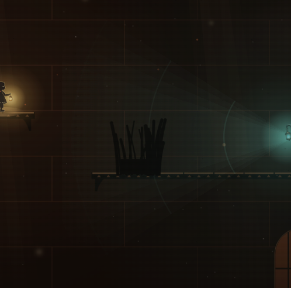
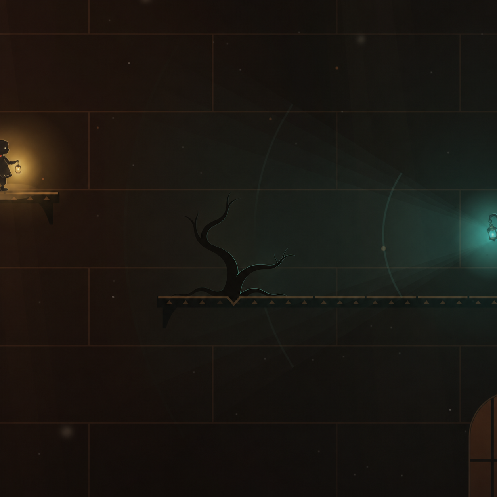
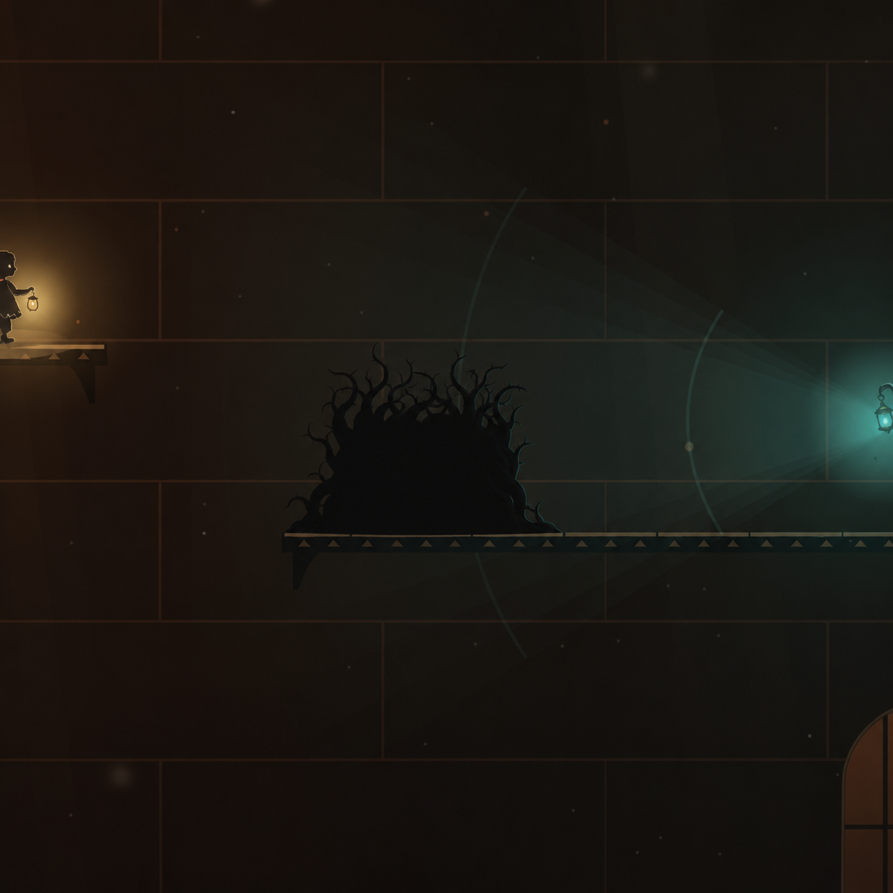
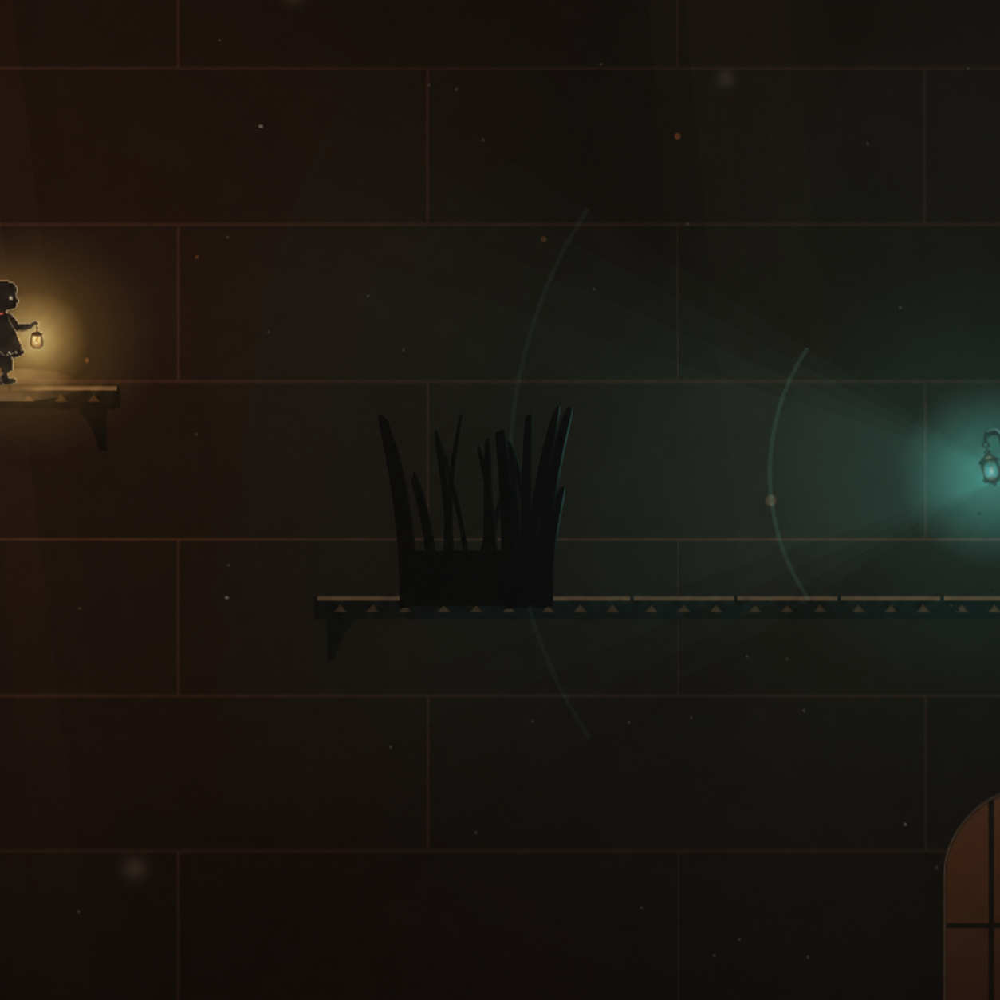

# Yerebatan devir notu · 10 Kasım 2026

## Saklanma çalısı

Yerebatan’daki mevcut ön plan çalısını gösteren oyun karesini ImageGen’in yerleşik görsel düzenleme aracına referans verdik. Her denemeyi aynı orijinal kareden ürettik. Şeffaflık istemedik çünkü amaç çalıyı oyunun ışığı ve ölçeği içinde değerlendirmekti. Bunlar dokümantasyon görselleri.

**Kaynak oyun karesi**



**1. Eğri kök denemesi**

Komut, ortadaki düz dalları tek eğri bir kök ve aralıklı dallarla değiştirmeyi, Kandilci tarafından çok hafif bir kenar ışığı vermeyi istedi. Seyrek gövde Sâye’yi örtecek alanı kaybettiği için bu yaklaşım elendi.



**2. Yoğun kök denemesi**

Komut, platformdan itibaren geniş, aralıksız bir alt siluet ve ince dalları örtünün üstünde istedi. Saklanma fikri geri geldi ancak siluet fazla büyüyüp yaratık hissi verdi. Bu yaklaşım da elendi.



**3. Mevcut çizimin rötuşu**

Son komut, dal dizilimini, boşlukları, boyutu ve dolu alt kısmı kaynak kareye bağladı. Yalnızca mevcut dal uçlarının hafifçe inceltilmesini, örtüşen sapların koyu tonlarla ayrılmasını ve fener tarafında belli belirsiz bir kenar çizgisi kullanılmasını istedi. Devam edilecek görsel yön bu örnek.



Bir sonraki iş, bu küçük rötuşu [ön plan çalı çizimine](../lib/game/terrain.dart) uygulamak. Önce ve sonra aynı kamera ölçeğinde, Sâye çömelirken ve Kandilci’nin feneri üzerinden geçerken karşılaştırılmalı. Çalının dolu alt silueti, zemine oturuşu ve haritadaki mevcut saklanma sınırları referans alınmalı.

## Bu oturumda oyuna girenler

- [Sâye’nin kuklası](../lib/game/kukla.dart) ve [oyuncu girdileri](../lib/game/player.dart) yürüyüş, nefes, itme, zincir, kaya kenarı, yüzüş ve sudan çıkış pozlarını paylaşıyor. Kavanozun konumu hareketin gerektirdiği tutuşa göre ayarlanıyor.
- [Kandilci çizimi](../assets/art/kandilci/) gövde, fener ve iki bot katmanı olarak yükleniyor. Adım, yürüdüğü mesafeye göre ilerliyor. [Hikâye perdesi](../lib/game/perde_acilis.dart) aynı figürü koyu siluet olarak çiziyor. Yangında fener yavaş salınıyor ve Usta’nın kapısında Kandilciler Karagöz ile Hacivat’ın önünden geçiyor.
- Yerebatan açılışında Blender’ın tonoz ve su yansıması katmanı, sıçrama kareleri ve hareket eğrileri [oyun varlığı olarak](../assets/art/yerebatan/) paketleniyor. Sâye’yi Flame’deki kukla çiziyor. Yüzüş taşın solunda bitiyor, el kenara bağlanıyor ve ön ayak yükselip sete basıyor.
- Karabasan’ın yaklaşırken gölgelerden toplanması, Medusa’nın gözünü açmadan önceki taş çatlağı ve su giriş-çıkış efektleri de kaynak kodda yer alıyor.

## Blender kaynağı ve doğrulama

[Düzenlenebilir Blender sahnesi](onizleme/yerebatan-devir/Yerebatan_Acilis.blend) açılışın arka planını, su sıçramasını ve Sâye’nin hareket zamanlamasını içerir. Karakter kuklası oyun kaynaklarında bulunur. [Üretim betiği](../tools/art/yerebatan_dusus.py) örnek komutla ayrı bir klasöre çıktı verir.

```sh
blender -b -t 6 --python tools/art/yerebatan_dusus.py -- /tmp/golge-yerebatan
```

Betik `zemin.png`, `dusus.json` ve `su_00.png` ile `su_17.png` arasındaki kareleri üretir. Oyun, su karelerini 320×144 piksellik hücrelerle, satır başına altı kare ve üç satır düzeninde tek bir `su.png` atlasından okur.

```sh
FPS=18 BASLA=5 ADET=138 flutter test tools/preview/acilis_video_test.dart
flutter build linux --release
```

Son Linux derlemesi ve açılışın Kandilci ile taş kenarı önizleme testleri geçti. Yeni Oyun açılış perdesini başlatır. Çalı rötuşu, oyuna eklendiğinde ayrıca saklanma ve fener görüşüyle birlikte denenmeli.
